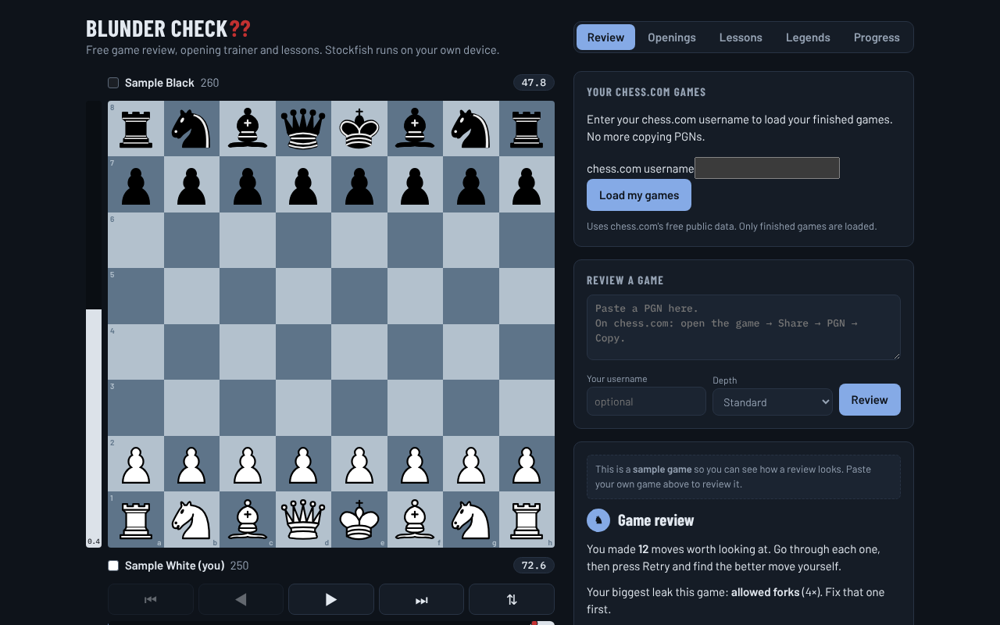
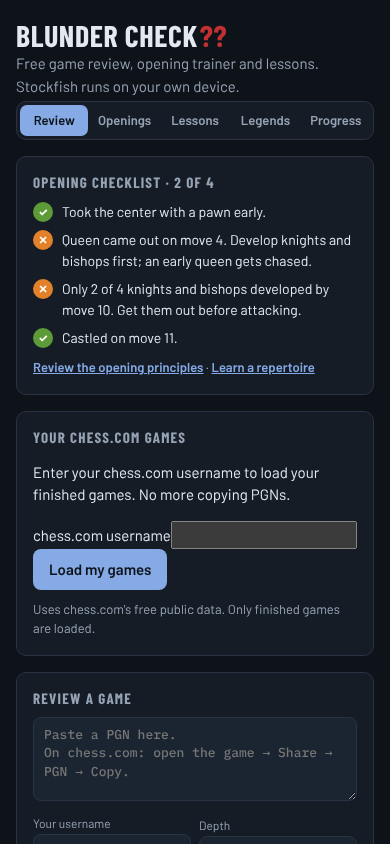

<picture>
  <source media="(prefers-color-scheme: dark)" srcset="assets/banner-dark.svg">
  
</picture>

<p align="center">
  <a href="https://cop1ouss.github.io/blunder-check/"></a>
</p>
<p align="center">
  
  
  
  
</p>

<p align="center">
  <a href="https://cop1ouss.github.io/blunder-check/"></a>
  <a href="https://cop1ouss.github.io/blunder-check/"></a>
</p>

This is a free alternative to paid "Game Review". It uses Stockfish, the free,
open-source engine from github.com/official-stockfish/stockfish, to review your
games after they are over. It explains your mistakes in plain words and turns
them into puzzles from your own games.

**Fair play:** only run this on finished games. Never use it while a game is in
progress. Reviewing your games afterwards is allowed on chess.com and lichess.
Getting engine help during a game is cheating and gets accounts banned.

## The phone app

`docs/` is Blunder Check packaged as an installable app (a Progressive Web
App), live at https://cop1ouss.github.io/blunder-check/. To install it:

- **iPhone:** open the app's link in **Safari**, tap **Share**, then **Add to Home Screen**.
- **Android:** open the link in **Chrome** and tap **Install app** (or ⋮ → **Install app**).

It opens full screen with its own icon and works offline: Stockfish runs on
the phone. Reviews and progress stay on the device, so use **Back up progress**
now and then.

Rebuild it after changing anything in `web/`:

```
cd web
python3 tools/build_app.py
```

## License

GPLv3 (see LICENSE), because the app ships the Stockfish engine, which is
GPLv3. Third-party components are listed in docs/NOTICE.md.

## Blunder Check: the full game review (web app)

`web/` is a free version of chess.com's Game Review. It runs Stockfish 17.1 in
your browser, so reviews are unlimited and nothing is uploaded:

- every move classified: Brilliant, Great, Best, Excellent, Good, Book,
  Inaccuracy, Mistake, Miss, Blunder
- an accuracy score for each player
- an eval bar and an eval graph you can click
- the opening name
- coach explanations: hung piece, fork, missed mate, walked into mate, missed
  free piece
- **Retry**: find the better move yourself

It is tuned for beginners. Giving away a piece is always flagged, even in a
position that is already won or lost.

To run it on your computer:

```
cd web
python -m http.server 8000
```

Then open http://localhost:8000/index.html. It has to come from a local web
server; double-clicking the file won't load the engine.

Rebuild the data (openings, piece art, sample game) with
`python -I tools/build_data.py RAW_DIR`, then run `python tools/make_local.py`.

## Setup for the command-line tools (one time)

1. Install **Python 3** from python.org. On Windows, tick "Add Python to PATH".
2. In a terminal, run: `pip install chess`
3. Install **Stockfish**:
   - Windows: download it from stockfishchess.org/download, unzip it, rename the
     `.exe` to `stockfish.exe`, and put it in this folder.
   - Mac: `brew install stockfish`
   - Linux: `sudo apt install stockfish`

## After every game (win or lose)

```
python review.py --chesscom YOUR_USERNAME --last 1
```

If that doesn't work, export the game yourself. On chess.com, open the game,
click **Share**, then **PGN**, then **Download**. Then run:

```
python review.py mygame.pgn --me YOUR_USERNAME
```

You get every blunder, why it was bad, the better move, and a lichess link to
step through it. At the end it tells you your **#1 leak**, the mistake you make
most often.

## Every day (10 minutes)

```
python drill.py
```

This drills positions from *your own* games where you went wrong. Positions you
miss come back more often. A position is retired after you solve it twice in a
row.

---

## The plan: 136 → 400

Below 400, games aren't decided by openings or strategy. They're decided by
**who hangs fewer pieces**. Nearly every game is lost to a piece left
unprotected, a free piece not taken, or a missed checkmate. Fix those and you
pass 400.

### 1. Use the blunder check before EVERY move

Ask these three questions, in this order:

1. **What did their last move do?** What does that piece attack now?
2. **Checks, captures, threats:** can I check, take something for free, or mate?
3. **Is my move safe?** Can the square I'm moving to be taken? Does my move
   leave anything else unprotected?

It feels slow at first. That's the point.

### 2. Play slower games

Play **10-minute or 15|10 rapid**, not 3-minute or bullet. You need time to do
the blunder check. Fast games build the habit of skipping it.

### 3. Training week

| Day       | What to do                                                        |
|-----------|-------------------------------------------------------------------|
| Every day | `drill.py` (10 min) + free lichess.org/training puzzles (15 min)  |
| Every day | 1–3 rapid games, each followed by `review.py`                     |
| Week 1–2  | Learn checkmate with king + queen vs king, until you can always do it |
| Week 3–4  | King + rook vs king checkmate; how to stop the 4-move "Scholar's mate" |
| Ongoing   | Opening rules: control the centre, develop knights and bishops, castle early, don't move the queen out early |

### 4. Milestones

- **~200**: you rarely hang a piece in one move. `review.py` shows fewer
  "Hung a piece" lines per game.
- **~300**: you take free pieces your opponent leaves, and spot mate in 1.
- **~400**: you finish won games. When you're a queen up, you deliver
  checkmate instead of running out of time or stalemating.

Watch the summary count from `review.py` go down over the weeks. Your rating
follows it.

## Tips

- Raise `--depth` (e.g. `--depth 18`) for a more accurate but slower review.
  The default 14 is plenty at this level.
- The lichess.org analysis board is also free if you want to explore a
  position move by move.

---

<p align="center"><sub>Built by <a href="https://github.com/Cop1ouss">Dajoni Gomez</a> · part of the <a href="https://cop1ouss.github.io/Cop1ouss/">Uncook</a> journey log</sub></p>
